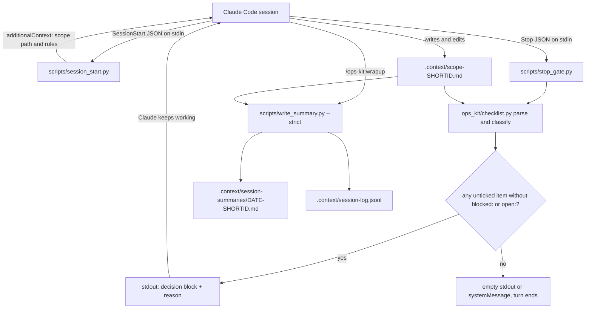

# claude-code-ops-kit

**Stops a Claude Code agent from saying "done" while agreed work is unfinished.**

If you run Claude Code on real tasks, you have seen a turn end with "all set" while one of the
three things you asked for was skipped, or was changed but never checked. You find out later.

This plugin is for developers and team leads who want that caught at the moment it happens:

1. At the start of a task, Claude writes the agreed scope to a small checklist file, one line
   per deliverable, each with a check that proves it.
2. When Claude tries to end its turn, a Stop hook reads the checklist. If any item is neither
   ticked nor labelled, the stop is refused and Claude is told which items to finish.
3. An item Claude cannot finish must be labelled `blocked:` (what the user has to do) or
   `open:` (next step and owner), so nothing is dropped silently.
4. A wrap-up command writes a short session summary and one log line from the same checklist.

It is plain Python, standard library only. The hooks never call a model or the network and use
no API keys. It checks the checklist, not the work itself; see [Limitations](#limitations).

License: MIT, see the LICENSE file.

## What you will see

Real output from `python demo/run_demo.py`, which pipes sample hook JSON through the same
scripts Claude Code runs (full capture in [demo/output.txt](demo/output.txt)). Claude has
written three scope items, ticked none, and tries to stop:

```
    stdout: {"decision": "block", "reason": ...}  ->  Claude keeps working. Reason:
      | ops-kit: 3 scope item(s) in .context/scope-d3m05e55.md are unresolved, so the turn cannot end yet.
      |   line 3 (unticked, no label): Add CSV export to the weekly report (done when: pytest tests/test_export.py passes)
      |   line 4 (unticked, no label): Update the README usage section (done when: grep -c "export" README.md is above 0)
      |   line 5 (unticked, no label): Email the sample file to Alex Sample at alex@example.com (done when: outbox shows the message)
```

After it ticks two items with evidence, labels one blocked and adds one open, the stop is allowed
and the loose ends are shown to the user instead of vanishing:

```
      | 2 done, 1 blocked, 1 open, 0 unlabeled
    Stop hook fires (stop_hook_active=true)
    exit code: 0
    stdout: {"systemMessage": "ops-kit: scope has 1 blocked and 1 open item(s) carried forward (.context/scope-d3m05e55.md)."}  ->  turn ends
```

This is a replay with invented data (Alex Sample, example.com), not a recording of a live
Claude Code session.

## What is in it

A Claude Code plugin (plugin name `ops-kit`) with four parts:

| Part | File | What it does |
| :- | :- | :- |
| Stop hook | `hooks/hooks.json`, `scripts/stop_gate.py` | When Claude tries to end a turn, reads this session's scope file. If any unticked item has no `blocked:` or `open:` label, it returns `{"decision": "block", "reason": ...}` listing those items, and Claude keeps working. |
| SessionStart hook | `scripts/session_start.py` | Adds the scope file path and the convention to Claude's context at startup, resume, clear, compact and fork. |
| `scope` skill | `skills/scope/SKILL.md` | How to write and close the checklist. Invoked as `/ops-kit:scope`. |
| `wrapup` skill | `skills/wrapup/SKILL.md`, `scripts/write_summary.py` | Writes a session summary from the checklist plus Claude's notes, and appends one line to a session log. Invoked as `/ops-kit:wrapup`. |

The scope file is `.context/scope-<first 8 characters of the session id>.md` in the working directory, one file per session, so sessions sharing a folder do not block each other. A file looks like this:

```
- [ ] Add retry to the sync job (done when: pytest tests/test_sync.py passes)
- [x] Rename the config key. evidence: grep shows 0 old references
- [ ] Rotate the staging token. blocked: needs an admin to approve the request
- [ ] Backfill old rows. open: next step is a dry run, owner is the data team
```

The first line would block the stop. The other three would not. Full rules are in [docs/scope-convention.md](docs/scope-convention.md).

## Architecture



## Run it

Requires Python 3.10 or later on `PATH` as `python` or `python3`. Nothing to install for the demo or the plugin itself.

```bash
git clone https://github.com/midcityhandyman/claude-code-ops-kit.git && cd claude-code-ops-kit
python demo/run_demo.py                 # offline walkthrough, no Claude Code needed
claude --plugin-dir .                   # load the plugin into a Claude Code session
```

The demo replays one session in a temporary folder: session start, a stop with no scope file, a blocked stop, an allowed stop after the checklist is resolved, then the wrap-up. `python demo/run_demo.py --save` regenerates `demo/output.txt`.

Inside a Claude Code session, ask for any task that changes files. Claude is told where the scope file goes, and the Stop hook holds the turn open until the checklist is resolved. Run `/ops-kit:wrapup` at the end.

## Tests

```bash
python -m pip install -r requirements-dev.txt
python -m pytest -q
```

54 tests, pytest is the only dependency. They feed sample hook JSON (`tests/fixtures/*.json`, written by hand to match the Stop and SessionStart inputs in the Claude Code hooks reference) into the same `main()` the hook runs. Two tests run the real entry scripts as subprocesses. `tests/test_plugin_files.py` checks the manifest, the hooks file and the skill frontmatter. CI (`.github/workflows/ci.yml`) runs the tests and the demo on Ubuntu and Windows with Python 3.10 and 3.12.

If you have the Claude Code CLI installed, `claude plugin validate .` checks the manifest and hook files as well. On CLI 2.1.331 it passes with one warning: the plugin has no icon.

## Settings

All optional, read from the environment. See [.env.example](.env.example).

| Variable | Default | Effect |
| :- | :- | :- |
| `OPS_KIT_SCOPE_DIR` | `.context` | Folder that holds scope files, relative to the working directory. |
| `OPS_KIT_REQUIRE_SCOPE` | `0` | `1` also blocks, once per stop, when the session has no checklist at all. |
| `OPS_KIT_REQUIRE_EVIDENCE` | `0` | `1` treats a ticked item without `evidence:` as unresolved. |
| `OPS_KIT_BLOCK_ONCE` | `0` | `1` blocks only the first stop in a row (allows when `stop_hook_active` is true). |
| `OPS_KIT_ALLOW_WHEN_BACKGROUND` | `1` | `1` lets the turn end while background tasks are running, with a note to the user. |
| `OPS_KIT_DISABLE` | `0` | `1` turns both hooks off. |

## Hook behavior in detail

- Input is the Stop hook JSON on stdin. Fields used: `session_id`, `cwd`, `hook_event_name`, `stop_hook_active`, `background_tasks`.
- To block, the script prints `{"decision": "block", "reason": "..."}` and exits 0. To allow, it prints nothing, or `{"systemMessage": "..."}` when blocked or open items are carried forward.
- The scope file is looked up under `cwd` first, then under `CLAUDE_PROJECT_DIR`, in case Claude changed directory mid-session.
- By default the hook keeps blocking on later stops in the same sequence, because the condition can always be resolved by labelling the item. Claude Code's own cap is the backstop: per its hooks reference, after eight stop-hook continuations in a row with no tool call it ends the turn anyway.
- The hook fails open. Invalid JSON, a missing field or an internal error exits 0 with a note on stderr, so a hook bug cannot trap a session.

## Background

The pattern comes from the author's own day-to-day agent setup for two small service businesses, where a turn that ends with loose ends costs someone time the next morning. The per-session scope file, the three end states and the wrap-up log are the parts that stayed in use. This repository is a clean rewrite with synthetic data only. It contains none of that setup's code or data and offers no measurements from it.

## Limitations

What it does not do:

- The gate checks the checklist, not the work. Claude can tick an item or write `open: later` without doing anything. `OPS_KIT_REQUIRE_EVIDENCE=1` requires an `evidence:` note on ticked items but does not verify that the evidence is true. No check command is ever executed by the hook.
- It only enforces what was written down. With the default settings a session with no scope file is never blocked, and writing the file depends on Claude following the SessionStart instructions.
- The label match is textual. An item whose own wording contains `open: something` (for example a quoted config key) reads as labelled.
- An unclosed code fence in the scope file hides every item after it.
- Only the main agent's Stop event is gated. Subagent stops are not.
- Scheduled wakeups (`session_crons` in the hook input) are ignored. Only running `background_tasks` make the gate treat a session as paused.
- A second wrap-up for the same session on the same day overwrites the summary file. The log still gets one line per wrap-up.
- The wrap-up summary is as good as the notes Claude writes. The script only merges them with the checklist. It writes local files only and sends nothing anywhere.

What has and has not been run:

- Never run inside a live interactive Claude Code session as part of this build. The evidence is the test suite, the demo, `claude plugin validate`, and the real hook command from `hooks/hooks.json` run by hand in Git Bash with JSON on stdin.
- The hook input in the tests and demo is sample JSON written from the Claude Code hooks documentation as of November 2026, not captured from a real session. If the hook formats change, this needs rechecking.
- CI covers Ubuntu and Windows. macOS is not in CI.
- The hook command is shell form and needs a POSIX shell (`sh` on macOS and Linux, Git Bash on Windows) plus `python` or `python3` on `PATH`. On Windows without Git Bash, Claude Code runs hooks through PowerShell and this command will not work as written. If `python` resolves to something older than 3.10, the hook errors and the turn simply ends ungated.
- There is no marketplace entry. The plugin loads with `--plugin-dir` only.
