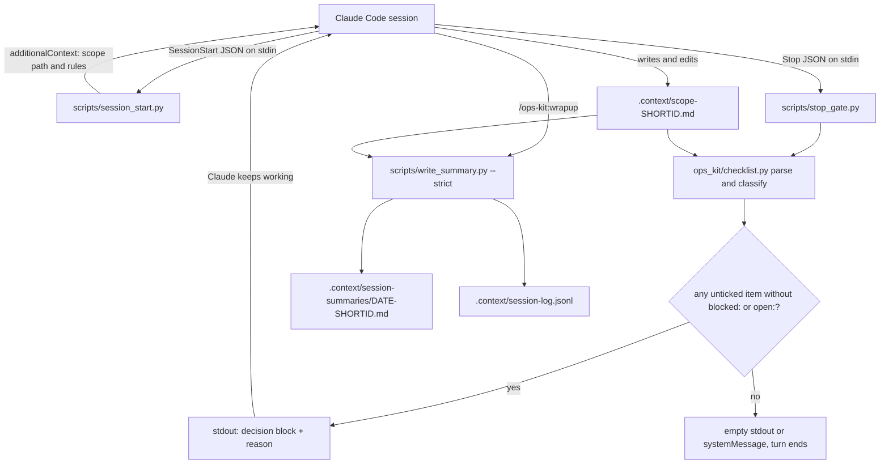

# claude-code-ops-kit

Coding agents often end a turn with "done" while part of the agreed work is unfinished or unverified.
This plugin makes the agent write the scope down first, then refuses to let the turn end until every item is done, blocked or open.

License: MIT, see the LICENSE file.

## What it does

A Claude Code plugin (plugin name `ops-kit`) with four parts:

| Part | File | What it does |
| :- | :- | :- |
| Stop hook | `hooks/hooks.json`, `scripts/stop_gate.py` | When Claude tries to end a turn, reads this session's scope file. If any unticked item has no `blocked:` or `open:` label, it returns `{"decision": "block", "reason": ...}` listing those items, and Claude keeps working. |
| SessionStart hook | `scripts/session_start.py` | Adds the scope file path and the convention to Claude's context at startup, resume, clear and compact. |
| `scope` skill | `skills/scope/SKILL.md` | How to write and close the checklist. Invoked as `/ops-kit:scope`. |
| `wrapup` skill | `skills/wrapup/SKILL.md`, `scripts/write_summary.py` | Writes a session summary from the checklist plus Claude's notes, and appends one line to a session log. Invoked as `/ops-kit:wrapup`. |

The scope file is `.context/scope-<first 8 characters of the session id>.md` in the working directory, one file per session. A line looks like this:

```
- [ ] Add retry to the sync job (done when: pytest tests/test_sync.py passes)
- [x] Rename the config key. evidence: grep shows 0 old references
- [ ] Rotate the staging token. blocked: needs an admin to approve the request
- [ ] Backfill old rows. open: next step is a dry run, owner is the data team
```

The first line would block the stop. The other three would not. Full rules are in [docs/scope-convention.md](docs/scope-convention.md).

All hook logic is plain Python, standard library only, in `ops_kit/`. The hooks never call a model or the network and use no API keys.

## Architecture



## Run it

Requires Python 3.10 or later on `PATH` as `python` or `python3`.

```bash
git clone <this repo> && cd claude-code-ops-kit
python demo/run_demo.py                 # offline walkthrough, no Claude Code needed
claude --plugin-dir .                   # load the plugin into a Claude Code session
```

Inside the session, ask for any task that changes files. Claude is told where the scope file goes, and the Stop hook holds the turn open until the checklist is resolved. Run `/ops-kit:wrapup` at the end.

## Tests

```bash
python -m pip install -r requirements-dev.txt
python -m pytest -q
```

49 tests. They feed sample hook JSON (`tests/fixtures/*.json`, shaped like the Stop and SessionStart inputs in the Claude Code hooks reference) into the same `main()` the hook runs, and one test runs the real entry script as a subprocess with JSON on stdin. `tests/test_plugin_files.py` checks the manifest, the hooks file and the skill frontmatter. CI (`.github/workflows/ci.yml`) runs the tests and the demo on Linux and Windows.

If you have the Claude Code CLI installed, `claude plugin validate .` checks the manifest and hook files as well.

## Demo

`python demo/run_demo.py` replays one session through the real hook scripts in a temporary folder: session start, a stop with no scope file, a stop that is blocked, a stop that is allowed after the checklist is resolved, then the wrap-up. The captured output is in [demo/output.txt](demo/output.txt). The blocked stop looks like this:

```
stdout: {"decision": "block", "reason": ...}  ->  Claude keeps working. Reason:
  | ops-kit: 3 scope item(s) in .context/scope-d3m05e55.md are unresolved, so the turn cannot end yet.
  |   line 3 (unticked, no label): Add CSV export to the weekly report (done when: pytest tests/test_export.py passes)
  |   ...
  | Give every listed item one of three end states in the scope file:
  |   done: finish it, verify it, tick it '- [x]' and add 'evidence: <check output or id>'
  |   blocked: keep '- [ ]' and add 'blocked: <first failing check and what the user must do>'
  |   open: keep '- [ ]' and add 'open: <next step and who owns it>'
```

All names and addresses in the demo and tests are invented (Alex Sample, example.com).

## Settings

All optional, read from the environment. See [.env.example](.env.example).

| Variable | Default | Effect |
| :- | :- | :- |
| `OPS_KIT_SCOPE_DIR` | `.context` | Folder that holds scope files, relative to the working directory. |
| `OPS_KIT_REQUIRE_SCOPE` | `0` | `1` also blocks, once per stop, when the session has no checklist at all. |
| `OPS_KIT_REQUIRE_EVIDENCE` | `0` | `1` treats a ticked item without `evidence:` as unresolved. |
| `OPS_KIT_BLOCK_ONCE` | `0` | `1` blocks only the first stop in a row (allows when `stop_hook_active` is true). |
| `OPS_KIT_ALLOW_WHEN_BACKGROUND` | `1` | `1` lets the turn end while background tasks are running, with a note to the user. |
| `OPS_KIT_DISABLE` | `0` | `1` turns both hooks off. |

## Hook behavior in detail

- Input is the Stop hook JSON on stdin. Fields used: `session_id`, `cwd`, `hook_event_name`, `stop_hook_active`, `background_tasks`.
- To block, the script prints `{"decision": "block", "reason": "..."}` and exits 0. To allow, it prints nothing, or `{"systemMessage": "..."}` when blocked or open items are carried forward.
- The scope file is looked up under `cwd` first, then under `CLAUDE_PROJECT_DIR`, in case Claude changed directory mid-session.
- By default the hook keeps blocking on later stops in the same sequence, because the condition can always be resolved by labelling the item. Claude Code's own cap on consecutive stop-hook continuations is the backstop.
- The hook fails open. Invalid JSON, a missing field or an internal error exits 0 with a note on stderr, so a hook bug cannot trap a session.

## Where this pattern runs

This is drawn from systems that run two small service companies day to day, where agent sessions do real operational work and a turn that ends with loose ends costs someone a morning. The per-session scope file, the three end states and the wrap-up log are the parts that held up in daily use. This repository is a clean rewrite with synthetic data only.

## Limitations

- The gate checks the checklist, not the work. Claude can tick an item or write `open: later` without doing anything. `OPS_KIT_REQUIRE_EVIDENCE=1` raises the bar slightly but does not verify that the evidence is true.
- It only enforces what was written down. With the default settings a session with no scope file is never blocked.
- The label match is textual. An item whose own wording contains `open: something` (for example a quoted config key) reads as labelled.
- The hook command is shell form and needs a POSIX shell (`sh` on macOS and Linux, Git Bash on Windows) plus `python` or `python3` on `PATH`. On Windows without Git Bash, Claude Code runs hooks through PowerShell and this command will not work as written.
- Only the main agent's Stop event is gated. Subagent stops are not.
- Tested against the hook and plugin formats in the Claude Code docs as of November 2026 and validated with `claude plugin validate` on CLI 2.1.331. It has not been exercised inside a live interactive session as part of this build, only through sample hook JSON and the real hook command run in a shell.
- The wrap-up summary is as good as the notes Claude writes. The script only merges them with the checklist.
